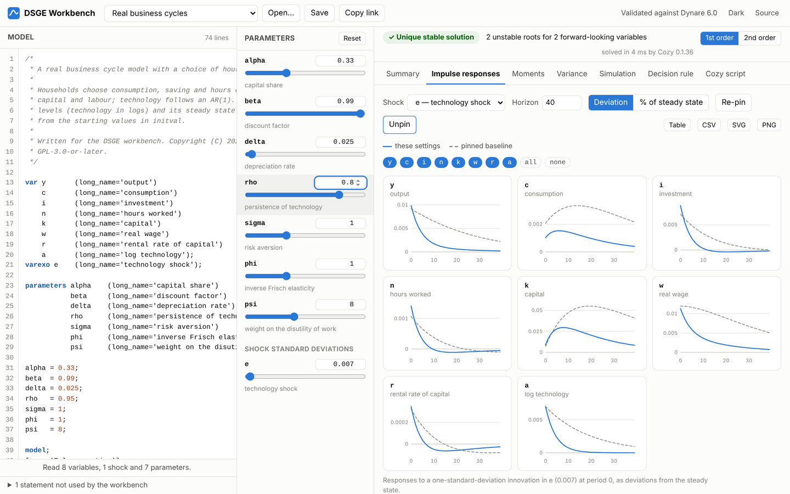
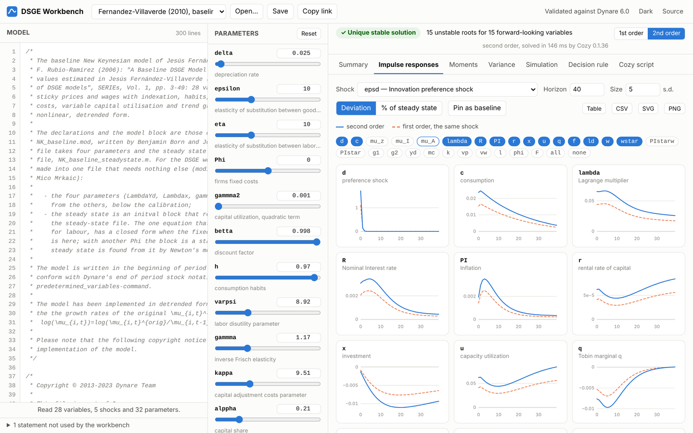
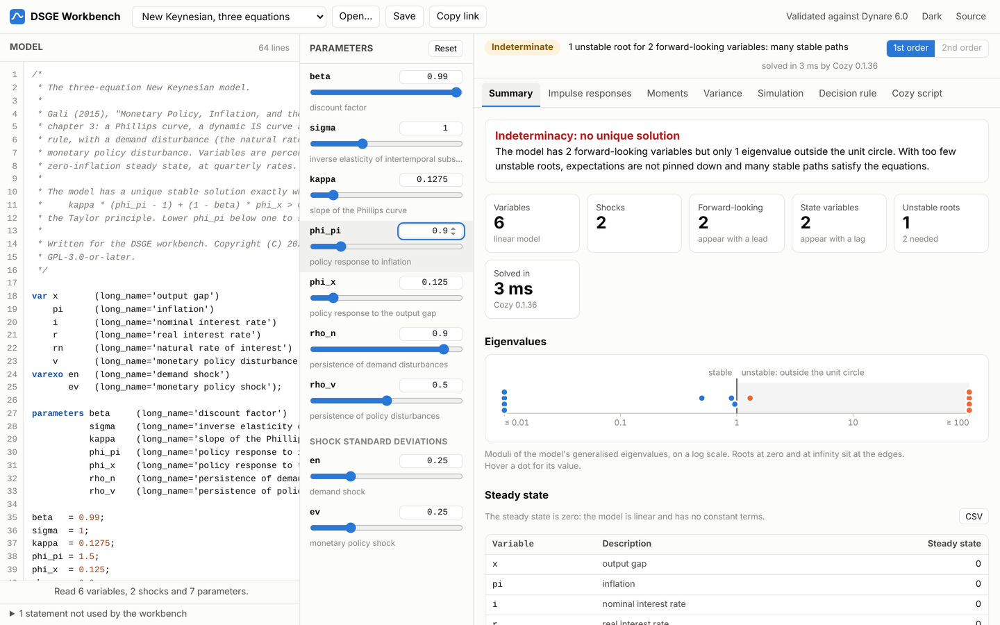
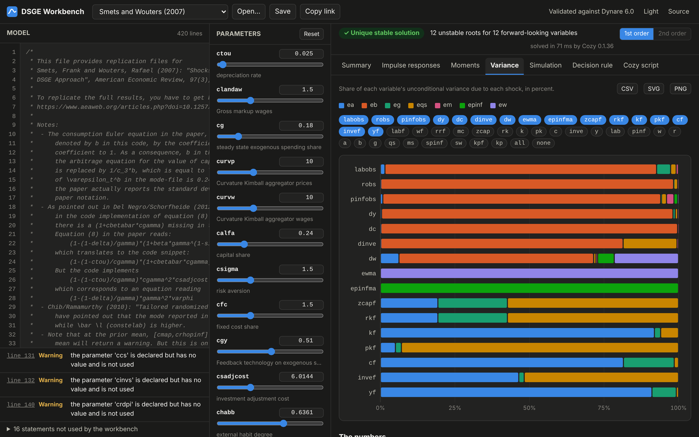

# DSGE Workbench

Solve and explore DSGE models in a browser tab. Paste a model written in
[Dynare](https://www.dynare.org)'s notation and get its steady state, the
Blanchard–Kahn check, impulse responses, theoretical moments and a variance
decomposition, recomputed as you drag a parameter, to first order or to
second. Nothing to install, and nothing leaves your machine.

**[Open the workbench](https://micomrkaic.github.io/dsge-workbench/)**

Its numbers are checked against Dynare 6.0 on eight models, from the
stochastic growth model to Smets and Wouters (2007). On seven they agree to
better than one part in a billion; on the eighth to one part in a million,
and there the workbench is the more accurate of the two. The second-order
solutions agree with Dynare's `order=2` to nine digits or better
([Validation](#validation)).

## What it does

- **Reads `.mod` files.** Declarations, parameter values, the model block
  with equation tags and model-local variables, leads and lags of any
  length (removed the way Dynare removes them, so that a term such as
  `1 / c(+2)` keeps its curvature), `steady_state()`, `initval`,
  `steady_state_model`, the `shocks`
  block with variances, covariances and correlations,
  `predetermined_variables`, and the `@#define` / `@#if` macro directives.
  Dynare's own example files load unmodified. An `initval` block written
  as formulas in the parameters is evaluated again when a parameter moves,
  as it is when Dynare runs the file again.
- **Says what it did not use.** Commands such as `estimation` and MATLAB
  statements are passed over and listed under the editor. Anything that
  would change the model's meaning and is not supported (optimal policy,
  explicit trends, deterministic shocks) is an error with a line number,
  not a silent omission.
- **Solves to first order.** Steady state by formula or by Newton's method,
  linearisation with exact derivatives (dual numbers, not finite
  differences), the Blanchard–Kahn count, and the decision rule
  `y = P y(-1) + Q e`.
- **Solves to second order, on request.** One switch adds the quadratic
  terms of the decision rule, again from exact derivatives. The summary
  then sets each variable's mean beside its steady state (risk moves it:
  precautionary saving, in the growth model). Responses are drawn for a
  shock of any size and sign against the first-order response to the same
  shock, because to second order three times the shock is not three times
  the response. Simulated paths are pruned, and can be shown as the
  second-order path, the first-order path for the same draws, or the
  difference. The decision-rule tab lists the coefficient on every product
  of two states or shocks. Correlated shocks are handled; a model declared
  `linear` has no second-order terms and stays at first order.
- **Treats indeterminacy as a result.** A model with too few or too many
  unstable roots gets a verdict and an eigenvalue chart, not an error
  message.
- **Turns parameters into sliders.** Every parameter with a numeric value
  gets one; parameters defined from others (`beta = 1 / (1 + rho)`) follow.
  Everything on the page is recomputed in a few milliseconds for a textbook
  model and in about 65 ms for Smets–Wouters.
- **Shows the results.** Impulse responses as small multiples with a
  pinnable baseline, moments and a correlation matrix, the variance
  decomposition, simulated paths and the policy and transition functions.
  Variables with a unit root (a price level, say) are reported as having no
  variance instead of breaking the whole table.
- **Lets the results out.** CSV for every table, SVG and PNG for every
  figure, the model as a `.mod` file, a link that carries the model and the
  moved parameters, and a script that reproduces the solution in Cozy.

## How it works

The page has two halves. The reader (`docs/js/modfile.js`) is ordinary
JavaScript: it parses the `.mod` text into syntax trees, introduces
auxiliary variables for long leads and lags, and reports problems with line
numbers. It solves nothing. For a lead of two periods or more it follows
Dynare's preprocessor: the auxiliary variable stands for the whole term
whose expectation is taken, not for the variable inside it. To first order
the two give the same solution; to second order only the first is right
(`E[1/x]` is not `1/E[x]`), and the correction for risk in Dynare's
`fs2000` example is six times off with the shortcut.

The numerical work is done by [Cozy](https://github.com/micomrkaic/cozy), a
small matrix language written in C, and its `dsge` package. The Cozy
interpreter is compiled to WebAssembly (`docs/vendor/cozy-engine.js`, about
910 kB) and runs in a web worker. `docs/js/solve.js` writes the model as
Cozy source, and a few functions of the workbench's own, also in Cozy
(`docs/js/prelude.js`), compute moments that cope with unit roots. The
"Cozy script" tab shows the model as a script you can run in Cozy's
command-line interpreter.

## Validation

`tools/dynare_reference.py` runs Dynare 6.0 on each bundled model and saves
its results in `test/reference/`. The tests solve the same files with the
workbench, in the same WebAssembly the browser loads, and compare:

| Model | Variables | Shocks | Largest relative difference |
|---|---:|---:|---:|
| Real business cycles (`rbc.mod`) | 8 | 1 | 1.0e-10 |
| Stochastic growth model (`growth.mod`) | 5 | 1 | 5.0e-11 |
| New Keynesian, three equations (`nk.mod`) | 6 | 2 | 8.3e-14 |
| Collard's RBC (Dynare `example1.mod`), correlated shocks | 6 | 2 | 6.9e-11 |
| Schorfheide (2000) (Dynare `fs2000.mod`), leads of two periods | 14 | 2 | 2.0e-10 |
| Galí (2015), baseline New Keynesian, with a unit root | 14 | 3 | 8.0e-10 |
| Fernández-Villaverde (2010), baseline New Keynesian (Dynare `NK_baseline.mod`) | 28 | 5 | 9.5e-7 |
| Smets and Wouters (2007) | 40 | 7 | 2.7e-11 |

The comparison covers the steady state, the decision rule, the eigenvalues,
impulse responses to every shock over 40 periods, standard deviations,
correlations, autocorrelations to lag 5 and the variance decomposition. A
difference is measured relative to the size of the quantity; the test fails
above 1e-6. Where Dynare reports no variance (a unit root), the workbench
must report none too.

To second order the reference is `stoch_simul(order=2)`, and the comparison
covers the second-order terms of the decision rule (Dynare's `ghxx`, `ghxu`,
`ghuu` and `ghs2`), the means, and a pruned simulation of 40 periods for a
fixed path of shocks:

| Model | States | Largest relative difference |
|---|---:|---:|
| Real business cycles | 2 | 5.1e-14 |
| Stochastic growth model | 2 | 1.3e-11 |
| Collard's RBC, correlated shocks | 3 | 1.1e-13 |
| Schorfheide (2000), leads of two periods | 4 | 1.2e-12 |
| Fernández-Villaverde (2010) | 11 | 1.9e-9 |

The other three models are declared `linear`: Dynare keeps them at first
order, and the workbench reports second-order terms that are exactly zero.

Two things the comparison brought out.

Dynare's default tolerance for a numerically computed steady state is about
6e-6, so the reference run asks for a tighter one. Without that, the
largest difference in the table would be Dynare's own steady-state error.

The one model that stands apart, Fernández-Villaverde's, is badly
conditioned (habits of 0.97, almost costless capital utilisation), and
there the two decision rules differ in the ninth digit. The 9.5e-7 is that
difference showing in a correlation that is nearly zero (-0.00045, between
investment and wage dispersion), where it is measured against a small
number. A decision rule `y = P y(-1) + Q e` can be checked without a second
opinion: it must satisfy the linearised model, `A P P + B P + C = 0`.
`node tools/rule_residual.mjs` puts both rules into that equation:

| Model | What the workbench's rule leaves | What Dynare's leaves |
|---|---:|---:|
| Fernández-Villaverde (2010) | 9.1e-13 | 6.1e-9 |
| Smets and Wouters (2007) | 6.7e-16 | 7.1e-15 |
| the other five it can compare | below 1e-15 | below 4e-15 |

On every model the workbench's rule fits at least as tightly, and on the
hard one by four orders of magnitude. (Solving that model's equation in
50-digit arithmetic gives the same ranking: the workbench's rule is within
1.3e-13 of the exact one, Dynare's within 1.6e-9.)

## Limits

- No third order. At second order the standard deviations, correlations
  and variance decomposition are those of the first-order solution (as in
  Dynare); only the means are second-order.
- Second-order responses are from the steady state with no other shocks,
  not Dynare's simulated averages over future shocks, so the two are not
  the same object and are not compared.
- No estimation, filtering or forecasting. `estimated_params`, `varobs` and
  `estimation` are read past.
- No occasionally binding constraints, optimal policy or perfect-foresight
  simulation.
- Moments are those of the unfiltered model (no HP filter).
- A variable that is stationary only as a combination of unit-root
  variables (a cointegrating relation written out in levels) may get
  inaccurate autocorrelations; its variance is still right.
- The macro language is limited to `@#define` and the `@#if` family; no
  `@#for`, `@#include` or `@{...}` substitution.

## Tests

    npm test

runs, with node 22 and nothing else installed:

- the comparison with Dynare for the eight models, to first order and to
  second (`test/validate.test.mjs`);
- 28 tests of the reader and the solver (`test/modfile.test.mjs`): each
  supported construct, operator precedence, error messages and their line
  numbers, auxiliary variables, correlated shocks, the Taylor principle,
  unit roots, a wrong `steady_state_model`, starting values that follow the
  parameters, Dynare's rule for long leads, second-order means, responses
  and pruned paths.

The page itself is driven in Chromium by `test/browser.mjs` (56 checks:
every tab, sliders, the pinned baseline, hover readouts, downloads, the
share link, the switch to second order and what each tab then shows, a
file opened from disk, both themes, a phone-width screen):

    python3 -m http.server -d docs 8767 &
    node test/browser.mjs http://localhost:8767/

## Layout

    docs/                   the site, as served
      index.html, app.css
      js/modfile.js         the .mod reader
      js/solve.js           model -> Cozy source -> named results
      js/prelude.js         the workbench's own Cozy functions
      js/engine.js          the page's side of the worker
      js/charts.js          SVG charts, no library
      js/app.js             the page
      worker/               the worker and the engine wrapper (also loaded by the tests)
      vendor/cozy-engine.js Cozy and its dsge package, as WebAssembly
      examples/             the bundled models
    test/                   tests, and Dynare's reference results
    tools/                  build the engine, run Dynare, write the validation table,
                            check each decision rule against the model

To run it locally, serve `docs/` over HTTP (a worker cannot start from a
`file://` page):

    python3 -m http.server -d docs

To rebuild the engine from a Cozy checkout (needs Emscripten):

    tools/build-engine.sh /path/to/cozy

To regenerate Dynare's reference results (needs Octave and Dynare):

    tools/dynare_reference.py && node tools/validation_report.mjs

## Licence

GPL-3.0-or-later; see `LICENSE`. The bundled model files from Dynare and
from Johannes Pfeifer's DSGE_mod collection keep their own copyright
notices, also under the GPL; see `NOTICE`.
